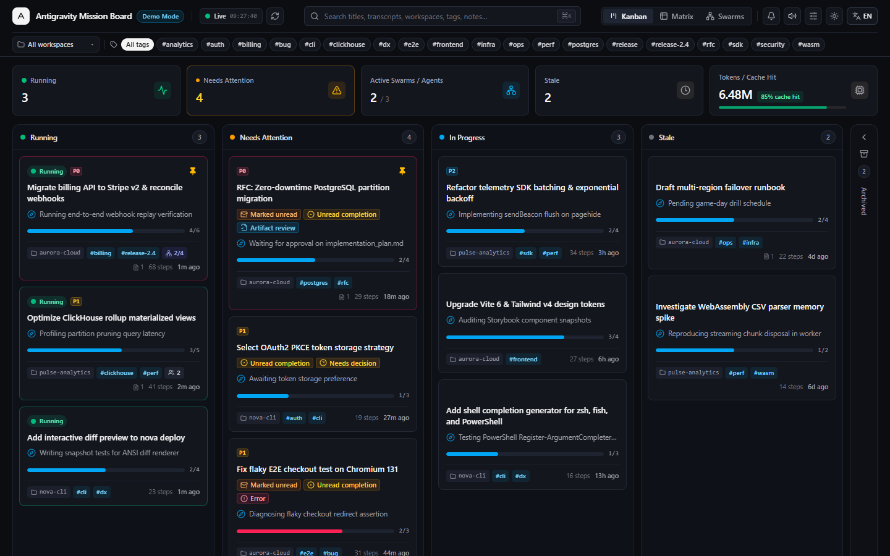
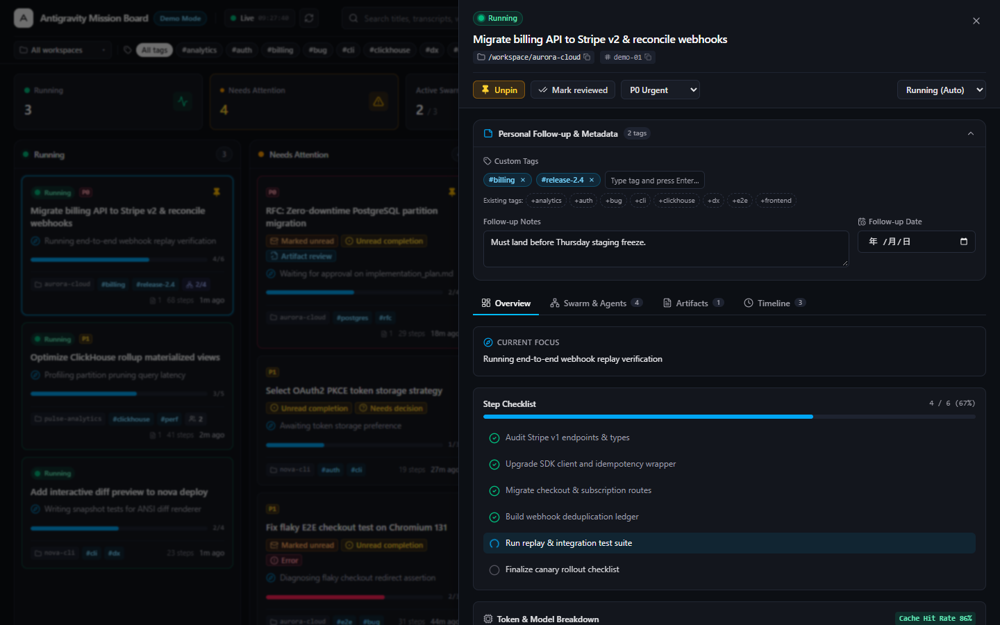
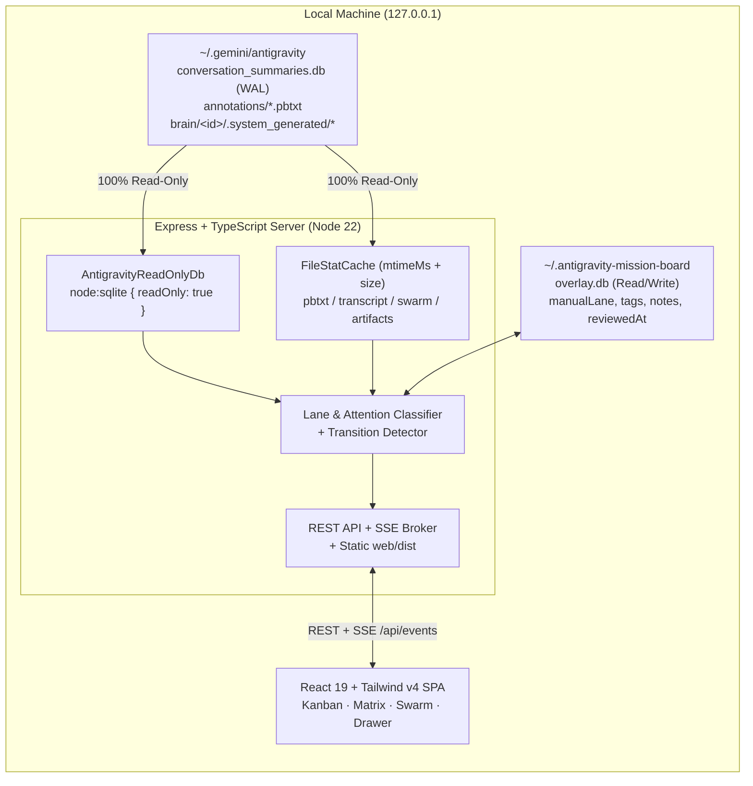

<div align="center">

# Antigravity Mission Board

**Local-first Kanban & Mission Control dashboard for Google Antigravity Desktop 2.0**

Track running agents, unread completions, pending decisions, multi-agent Swarms, subagent trees, checklists, artifacts, and token usage — **100% read-only** on your Antigravity data with **zero native C++ build dependencies**.

[](https://github.com/Lovlace777/antigravity-mission-board/actions/workflows/ci.yml)
[](https://nodejs.org/)
[](https://www.typescriptlang.org/)
[-0F766E)](https://nodejs.org/api/sqlite.html)
[](./LICENSE)

**English** · [简体中文](./README.zh-CN.md)

</div>



> *All screenshots in this repository are rendered from the built-in synthetic Demo Mode (`npm run start:demo`). Zero private user data is included.*

---

## Why Antigravity Mission Board?

When you run multiple Antigravity Desktop 2.0 conversations, Swarms, and background subagents across projects, it becomes hard to tell at a glance:

- Which agents are **actively executing right now** (including Swarms whose coordinator is waiting on a working worker)?
- Which tasks **just finished unread**, hit an **execution error**, paused on **`ask_question`**, or have a **`requestFeedback` artifact** waiting for your approval?
- Which workstreams have gone **stale** without follow-up?

**Antigravity Mission Board** reads Antigravity's local metadata directly from `~/.gemini/antigravity` in strict read-only mode, classifies every root conversation automatically, and overlays your own local priorities, pins, custom tags, manual lane overrides, and follow-up notes in a separate SQLite database.

---

## Highlights

- **Automatic 5-Lane Kanban + Drag & Drop** — `Running`, `Needs Attention`, `In Progress`, `Stale`, and collapsible `Archived` rail. Drag cards across columns to set a manual lane override while keeping live running indicators and one-click reset to auto-classification.
- **High-Signal Attention Radar** — Automatically surfaces `marked_as_unread`, `unread_update`, `needs_input` (pending `ask_question`), `request_feedback` artifacts, `error` turns, and due follow-up reminders. Dismiss alerts cleanly via **Mark Reviewed** without ever writing to Antigravity's files.
- **Swarm & Multi-Agent Cluster View** — Dedicated view of `plan.json` goals & threads, worker rosters (`working` / `waiting` / `stopped` / `killed` + model), live board message feeds, and recursive subagent trees.
- **Slide-Over Detail Drawer** — Inspect live `update_steps` checklists (with automatic `transcript_full.jsonl` fallback when compact logs truncate), token & cache hit-rate breakdowns, inline GFM Markdown artifact previews, chronological turn timelines, and autosaving personal notes & tags.
- **High-Density Project Matrix View** — Group by workspace, tag, or lane and sort by recency, attention, priority, steps, or token usage.
- **Real-Time SSE & Desktop Alerts** — Live Server-Sent Events stream pushes snapshot diffs on changes plus optional Web Notifications & subtle chime when a running agent completes, asks a question, or hits an error.
- **Bilingual UI & Crisp Light/Dark Themes** — Instant `中文` / `EN` switcher and refined Linear/Raycast-inspired Light & Dark surfaces.
- **Zero Native Dependencies** — Powered by Node 22's built-in `node:sqlite` (`DatabaseSync`) with automatic `conversations_fts_content` shadow-table fallback for full compatibility across all Node 22.5+ builds on Windows, macOS, and Linux.

---

## Visual Tour

### Light Mode Kanban


### Slide-Over Detail Drawer (Checklist, Notes, Artifacts & Timeline)


### Swarm & Multi-Agent Cluster Monitor


---

## Quick Start

### Prerequisites
- **Node.js 22.5+** (required for built-in `node:sqlite`; tested on Node 22.13+ on Windows, macOS, and Linux)
- **Google Antigravity Desktop 2.0** (optional if running `--demo` mode)

### 1. Install & Build
```bash
git clone https://github.com/Lovlace777/antigravity-mission-board.git
cd antigravity-mission-board
npm run setup
npm run build
```

### 2. Run Locally (Live Read-Only Mode)
```bash
npm start
```
Open **http://127.0.0.1:3777** in your browser.

### One-Click Launchers
- **Windows:** Double-click `start.bat` (auto-installs/builds on first run, opens `http://127.0.0.1:3777`, and starts the server). Pass `--demo` for demo mode: `start.bat --demo`.
- **macOS / Linux:** Run `./start.sh` (or `./start.sh --demo`).

### Try Demo Mode (No Antigravity Installation Required)
Explore a realistic synthetic dataset (3 projects, 14 conversations across all 5 lanes, 2 Swarms, subagents, checklists, and Markdown artifacts) with interactive in-memory overlay mutations:
```bash
npm run start:demo
```

---

## Architecture



---

## Read-Only Safety & Privacy Guarantees

1. **Strictly Read-Only on Antigravity Storage:** `conversation_summaries.db` is opened exclusively with `new DatabaseSync(dbPath, { readOnly: true })` + `PRAGMA query_only = ON`, and closed immediately after each snapshot so Antigravity WAL checkpoints are never blocked. Mission Board **never writes, modifies, or deletes** anything inside `~/.gemini/antigravity`.
2. **Isolated Local Overlay Store:** Your personal Kanban metadata (manual lane overrides, pins, priorities, custom tags, notes, follow-up reminders, reviewed timestamps, and settings) lives separately in `~/.antigravity-mission-board/overlay.db`.
3. **Localhost-Only by Default:** The HTTP server binds strictly to `127.0.0.1:3777` and sends zero telemetry or outbound network requests.
4. **Path-Traversal-Safe Artifact Reader:** `/api/conversations/:id/artifact` validates conversation IDs, blocks `..`, absolute paths, drive letters, `.system_generated` internals, and symlink escapes via `realpathSync` containment, and caps reads at 512 KB.

---

## Environment Variables

| Variable | Default | Description |
| --- | --- | --- |
| `PORT` | `3777` | HTTP listen port |
| `HOST` | `127.0.0.1` | Bind address (keep `127.0.0.1` for local-only access) |
| `ANTIGRAVITY_DATA_DIR` | `~/.gemini/antigravity` | Override Antigravity Desktop 2.0 local data directory |
| `OVERLAY_DB_PATH` | `~/.antigravity-mission-board/overlay.db` | Override Mission Board overlay SQLite database path |
| `DEMO_MODE` | `0` | Set to `1` or `true` (or pass `--demo`) to run with the synthetic demo dataset |

---

## REST & SSE API Overview

All endpoints are served under `http://127.0.0.1:3777`:

| Endpoint | Description |
| --- | --- |
| `GET /api/health` | Runtime mode (`live` \| `demo`), version, data directory & DB accessibility, uptime |
| `GET /api/board` | Full board snapshot: root `ConversationCard[]`, `stats`, `workspaces`, `projects`, `tags`, `settings`, `activeSwarms` |
| `GET /api/conversations/:id` | Detailed `ConversationDetail` (checklist, Swarm detail & board feed, recursive subagent tree, artifacts, timeline, tokens) |
| `GET /api/conversations/:id/artifact?file=...` | Path-traversal-safe artifact text/Markdown reader (max 512 KB) |
| `PATCH /api/conversations/:id/overlay` | Update `manualLane`, `pinned`, `priority`, `tags`, `notes`, `followUpAt`, or `reviewedAt` |
| `POST /api/conversations/:id/review` | Convenience action setting `reviewedAt = now` to clear pending attention alerts |
| `GET /api/search?q=...` | Full-text search across transcripts (FTS5 / shadow fallback), titles, previews, tags, and notes |
| `GET /api/settings` · `PATCH /api/settings` | Read or update `staleAfterHours` and `pollIntervalMs` |
| `GET /api/events` | Server-Sent Events stream (`connected`, `heartbeat`, snapshot-diff `board_update`, semantic `notification`) |

---

## Keyboard Shortcuts

- `Ctrl+K` or `/` — Focus global search
- `1` / `2` / `3` — Switch between **Kanban**, **Matrix**, and **Swarm** views
- `Esc` — Close detail drawer or settings popover

---

## Development & Testing

```bash
# Run backend (tsx watch) + frontend (Vite HMR) together
npm run dev

# Run dev mode with synthetic demo data
npm run dev:demo

# Typecheck both server and web
npm run typecheck

# Run backend Vitest suite (parsers, classifier, overlay DB, REST/SSE & security)
npm test

# Production build (server tsc + web vite build)
npm run build
```

---

## License

[MIT](./LICENSE) © 2026 Antigravity Mission Board Contributors
