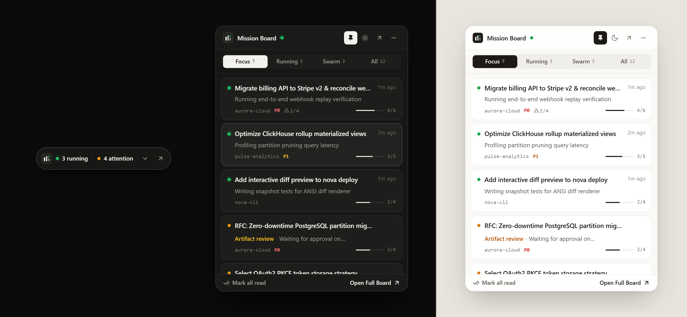
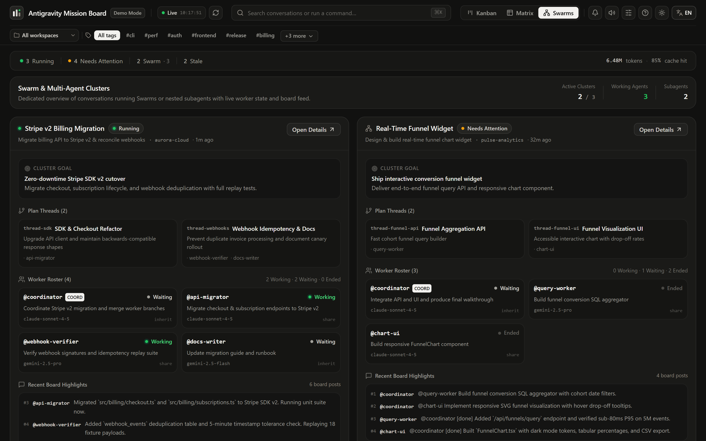
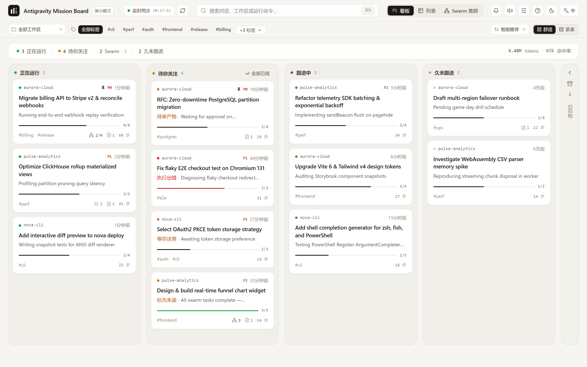
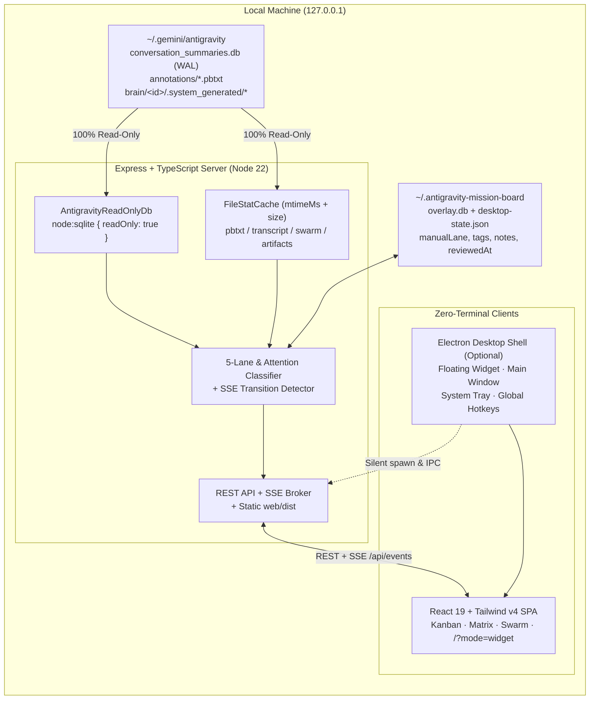

<div align="center">


<h1>Antigravity Mission Board</h1>

<p><strong>A calm, editorial Mission Control Kanban &amp; always-on-top Desktop Floating Widget for Google Antigravity Desktop 2.0 — zero terminal window, zero C++ build deps, 100% read-only.</strong></p>

<p>
  <a href="https://github.com/Lovlace777/antigravity-mission-board/actions/workflows/ci.yml"></a>
  <a href="https://github.com/Lovlace777/antigravity-mission-board/releases/tag/v2.0.0"></a>
  
  <a href="https://nodejs.org/">= 22.5" /></a>
  <a href="https://nodejs.org/api/sqlite.html"></a>
  
  <a href="./LICENSE"></a>
</p>

<p>
  <strong>English</strong> · <a href="./README.zh-CN.md">简体中文</a>
</p>

<p>
  <a href="#quick-start">Quick Start</a> ·
  <a href="#visual-tour">Visual Tour</a> ·
  <a href="#how-it-compares">How It Compares</a> ·
  <a href="#read-only-privacy--safety-pledge">Privacy &amp; Safety</a> ·
  <a href="#architecture">Architecture</a> ·
  <a href="#keyboard-shortcuts">Shortcuts</a>
</p>

<br />

<picture>
  <source media="(prefers-color-scheme: dark)" srcset="docs/screenshots/kanban-dark.png" />
  <source media="(prefers-color-scheme: light)" srcset="docs/screenshots/kanban-light.png" />
  
</picture>

<sub><em>All screenshots are rendered from the built-in synthetic Demo Mode (<code>npm run start:demo</code> / <code>npm run desktop:demo</code>). Zero private data or real user conversations are ever included.</em></sub>

</div>

---

## Quick Start

> **Prerequisite:** **Node.js 22.5+** — uses Node's built-in `node:sqlite` (`DatabaseSync`), so Windows, macOS, and Linux require **zero Python, zero `node-gyp`, and zero C++ build tools**.

### Option 1 — Seamless Desktop App + Floating Widget *(Recommended, Zero Terminal Window)*

Run an invisible, always-on-top **Dynamic-Island Floating Widget** + **System Tray** + **Native Board Window** with global hotkeys (`Ctrl+Shift+W` / `Ctrl+Shift+M`), Launch at Login, and zero lingering CMD windows:

```bash
git clone https://github.com/Lovlace777/antigravity-mission-board.git
cd antigravity-mission-board
npm run setup && npm run setup:desktop && npm run build

# Launch live against ~/.gemini/antigravity (100% read-only)
npm run desktop

# Or try the built-in synthetic demo dataset right away
npm run desktop:demo
```

**Windows 1-Click Native Shortcut (Desktop & Start Menu — Zero CMD Window):**
```bash
# Creates native Desktop + Start Menu shortcuts launching electron.exe directly
npm run desktop:install

# Optional: also enable Launch at Login
powershell -ExecutionPolicy Bypass -File desktop/scripts/install-windows-shortcut.ps1 -EnableAutoStart
```

### Option 2 — Lightweight Silent Web Mode *(No Electron Required)*

Prefer keeping things in your browser without downloading Electron?

| Platform | Live Mode (Real Antigravity Data) | Synthetic Demo Mode (10s Try-It) |
| --- | --- | --- |
| **Windows (Zero CMD Window)** | Double-click **`start-silent.vbs`** | `wscript start-silent.vbs --demo` |
| **Windows (Terminal)** | Double-click **`start.bat`** | `start.bat --demo` |
| **macOS / Linux** | **`./start.sh`** | `./start.sh --demo` |
| **Cross-platform CLI** | **`npm start`** | `npm run start:demo` |

Open **http://127.0.0.1:3777** — your local Antigravity sessions appear immediately in strict read-only mode.

---

## Visual Tour

### 1. Always-On-Top Desktop Floating Widget & Zero-Terminal Tray App
A featherweight frameless desktop HUD that stays neatly anchored to your screen edge above your editor or browser — zero console window, zero clutter:
- **Collapsed Capsule (`276×56`):** Live breathing status dot (`3 Running · 4 Attention` or calm `All clear`), draggable anywhere on screen with persisted position.
- **Expanded Triage Panel (`392×540`):** Instant `Focus / Running / Swarm / All` tabs, whisper-thin progress bars, 1-click hover `Read` + **Undo**, Light/Dark sync, Always-on-Top pin, and direct click-through to any conversation's Detail Drawer in the full window.
- **System Tray + Global Hotkeys:** Closing the full board hides quietly to the System Tray; summon the Floating Widget (`Ctrl+Shift+W`) or Full Board (`Ctrl+Shift+M`) from anywhere, and toggle **Launch at Login** in one click.



### 2. Floating Command Palette (`Ctrl+K` / `/`) & Instant Triage
Jump to any conversation via live local + full-text search, switch views, toggle themes or compact density, or mark every pending alert reviewed without touching the mouse. Hovering any Kanban card reveals quiet quick actions (`Pin` · `Priority` · `Mark Reviewed`), and every batch review or drag-and-drop move supports instant **Undo**.


### 3. Slide-Over Detail Drawer & Rich Markdown Artifacts
Inspect live `update_steps` checklists (with automatic `transcript_full.jsonl` fallback when compact logs truncate), token & cache hit-rate breakdowns, chronological turn timelines, and crisp GFM Markdown artifact previews (checklists, metrics tables, syntax-styled code fences). Personal tags, notes, and follow-up dates collapse into a quiet 1-line summary bar, with `←` / `→` keyboard triage across cards.


### 4. Swarm & Multi-Agent Cluster Monitor
Track active and completed Swarms in one focused view: inspect `plan.json` goals and thread assignments, live worker states (`working` / `waiting` / `stopped` / `killed` + model), board message feeds, and recursive subagent trees.



### 5. High-Density Project Matrix View
Managing 30+ conversations across repositories? Press `2` for **Project Matrix** — group by workspace, tag, or lane and sort by recency, attention, priority, step count, or token usage with inline pinning and one-click review.


<details>
<summary><strong>More Screenshots: Warm Alabaster Light Mode &amp; Simplified Chinese UI (中文界面)</strong></summary>

<br />

#### Warm Alabaster Paper Light Mode


#### Simplified Chinese Light Mode (中文浅色)


#### Simplified Chinese Dark Mode (中文深色)


</details>

---

## How It Compares

| Capability | **Antigravity Mission Board** | Quota / Account Monitors | Static History Viewers | External CLI Orchestrators |
| --- | :---: | :---: | :---: | :---: |
| Always-on-top Desktop Floating Widget & zero-terminal System Tray | ✅ | ❌ | ❌ | ❌ |
| Passive support for existing Antigravity Desktop 2.0 sessions | ✅ | ✅ | ✅ | ❌ |
| 5-Lane Auto Kanban (`Running` / `Attention` / `In Progress` / `Stale` / `Archived`) + DnD | ✅ | ❌ | ❌ | ⚠️ Partial |
| Real-Time Attention Radar (`ask_question`, `requestFeedback`, unread, error, batch review + Undo) | ✅ | ❌ | ❌ | ❌ |
| Native Swarm `plan.json` threads, worker roster & board monitor | ✅ | ❌ | ❌ | ❌ |
| Floating `Ctrl+K` Command Palette, card density toggle & keyboard triage | ✅ | ❌ | ❌ | ❌ |
| Zero C++ native deps on Windows/macOS/Linux (`node:sqlite` + FTS shadow fallback) | ✅ | ⚠️ Varies | ⚠️ Varies | ⚠️ Varies |
| 100% Read-Only on `~/.gemini/antigravity` & fully offline | ✅ | ✅ | ✅ | ❌ |

---

## Read-Only Privacy & Safety Pledge

- **100% Read-Only on Antigravity Storage:** `conversation_summaries.db` is opened exclusively with `new DatabaseSync(dbPath, { readOnly: true })` and `PRAGMA query_only = ON`, then closed immediately after each snapshot so Antigravity WAL checkpoints are never blocked. Mission Board **never writes, modifies, or deletes** any file inside `~/.gemini/antigravity`.
- **Isolated Local Overlay Store:** Your personal Kanban metadata (manual lanes, pins, priorities, custom tags, notes, reminders, `reviewedAt` timestamps, settings, and desktop widget anchor) lives separately inside `~/.antigravity-mission-board/`.
- **Localhost-Only & Zero Telemetry:** Binds strictly to `127.0.0.1:3777` by default with zero outbound requests or analytics.
- **Hardened Artifact Reader:** `/api/conversations/:id/artifact` validates conversation IDs, blocks `..`, absolute paths, Windows drive letters, `.system_generated` internals, and symlink escapes via `realpathSync` containment, and caps responses at 512 KB.
- **Universal Node 22+ Compatibility:** Automatically falls back to SQLite's regular `conversations_fts_content` shadow table on Node 22.5–22.15 builds compiled without FTS5 — zero native addons needed.

---

## Architecture



---

## Keyboard Shortcuts

| Scope | Shortcut | Action |
| --- | --- | --- |
| **Global (Desktop App)** | `Ctrl+Shift+W` / `⌘⇧W` | Toggle always-on-top Desktop Floating Widget |
| **Global (Desktop App)** | `Ctrl+Shift+M` / `⌘⇧M` | Toggle / focus Full Mission Board window |
| **In-App** | `Ctrl+K` / `⌘K` / `/` | Open floating Command Palette (search + quick commands) |
| **In-App** | `1` / `2` / `3` | Switch between **Kanban**, **Project Matrix**, and **Swarm Clusters** |
| **In-App** | `←` / `→` | Navigate previous / next conversation while Detail Drawer is open |
| **In-App** | `R` | Refresh board snapshot immediately |
| **In-App** | `?` | Open Keyboard Shortcuts cheatsheet |
| **In-App** | `Esc` | Close Command Palette, Detail Drawer, or modal |

---

<details>
<summary><strong>Environment Variables</strong></summary>

| Variable | Default | Description |
| --- | --- | --- |
| `PORT` | `3777` | HTTP listen port |
| `HOST` | `127.0.0.1` | Bind address (keep `127.0.0.1` for local-only access) |
| `ANTIGRAVITY_DATA_DIR` | `~/.gemini/antigravity` | Override Antigravity Desktop 2.0 local data directory |
| `OVERLAY_DB_PATH` | `~/.antigravity-mission-board/overlay.db` | Override Mission Board local overlay SQLite path |
| `DEMO_MODE` | `0` | Set to `1` or `true` (or pass `--demo`) to run with the synthetic demo dataset |

</details>

<details>
<summary><strong>REST &amp; SSE API Reference</strong></summary>

All endpoints are served under `http://127.0.0.1:3777`:

| Endpoint | Description |
| --- | --- |
| `GET /api/health` | Runtime mode (`live` \| `demo`), version (`2.0.0`), data directory & DB accessibility, uptime |
| `GET /api/board` | Full board snapshot: root `ConversationCard[]`, `stats`, `workspaces`, `projects`, `tags`, `settings`, `activeSwarms` |
| `GET /api/conversations/:id` | Detailed `ConversationDetail` (checklist, Swarm detail & board feed, recursive subagent tree, artifacts, timeline, tokens) |
| `GET /api/conversations/:id/artifact?file=...` | Path-traversal-safe artifact Markdown/text reader (max 512 KB) |
| `PATCH /api/conversations/:id/overlay` | Update `manualLane`, `pinned`, `priority`, `tags`, `notes`, `followUpAt`, or `reviewedAt` |
| `POST /api/conversations/:id/review` | Set `reviewedAt = now` to clear pending attention alerts for one conversation |
| `POST /api/conversations/review-batch` | Batch update `reviewedAt` for up to 200 conversation IDs (supports `reviewedAt: null` for Undo) |
| `GET /api/search?q=...` | Full-text search across transcripts (FTS5 / shadow fallback), titles, previews, tags, and notes |
| `GET /api/settings` · `PATCH /api/settings` | Read or update `staleAfterHours` and `pollIntervalMs` |
| `GET /api/events` | Server-Sent Events stream (`connected`, `heartbeat`, snapshot-diff `board_update`, semantic `notification`) |

</details>

<details>
<summary><strong>Development, Desktop &amp; Packaging Commands</strong></summary>

```bash
npm run dev               # Run backend (tsx watch) + frontend (Vite HMR) together
npm run dev:demo          # Run dev servers against synthetic Demo Mode
npm run desktop           # Launch zero-terminal Desktop App + Floating Widget (live mode)
npm run desktop:demo      # Launch Desktop App + Floating Widget in Demo Mode
npm run desktop:install   # Create Windows Desktop + Start Menu shortcuts (zero CMD)
npm run desktop:uninstall # Remove Windows shortcuts & auto-start entry
npm run desktop:dist      # Build standalone portable/installer package via electron-builder
npm run desktop:check     # Fast zero-download syntax check for desktop/*.cjs
npm run typecheck         # Strict TypeScript check across server + web
npm test                  # Run backend Vitest unit + API + security test suite
npm run build             # Production build (server tsc + web vite build)
```

</details>

---

## Contributing & License

Contributions, bug reports, and feature ideas are warmly welcome — see [CONTRIBUTING.md](./CONTRIBUTING.md) to get started.

Licensed under the [MIT License](./LICENSE).
