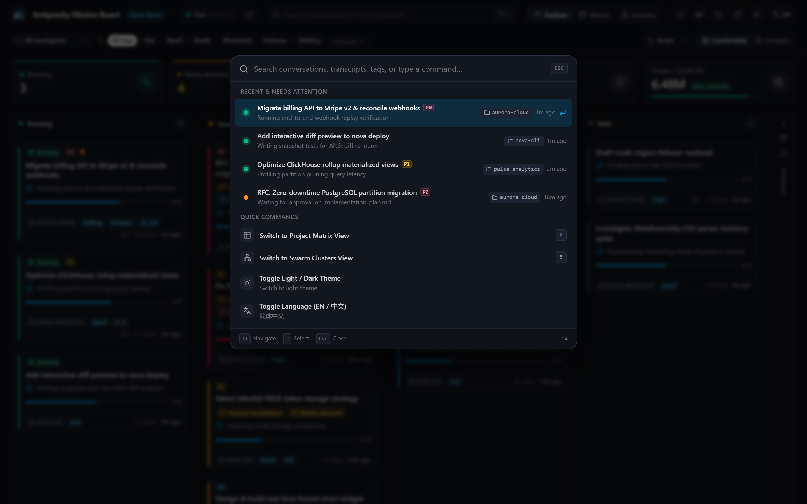
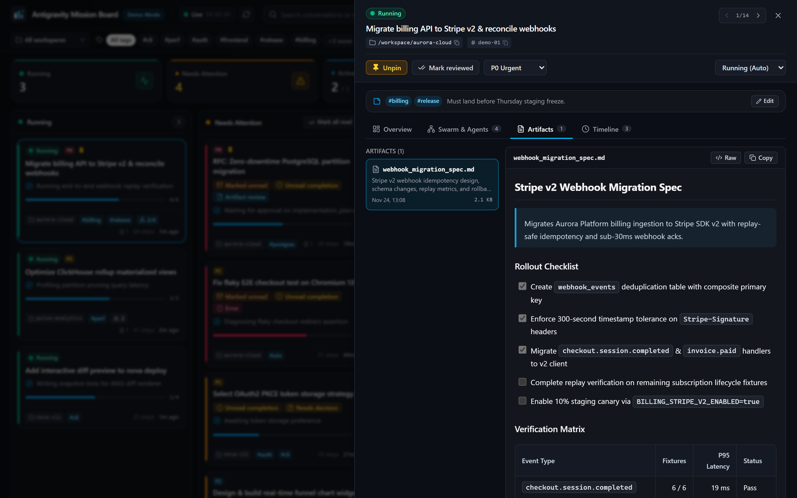
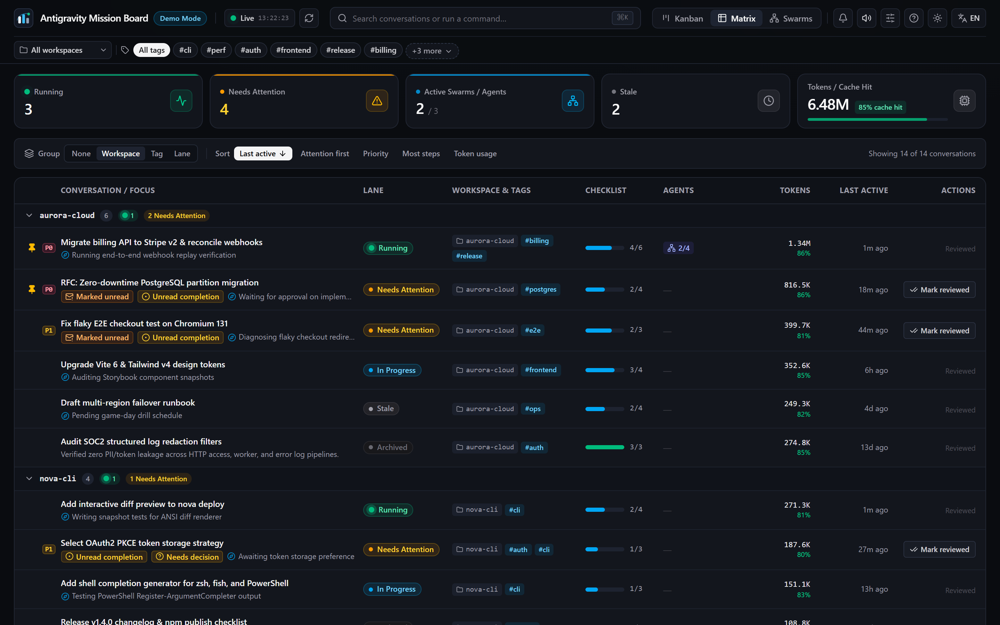
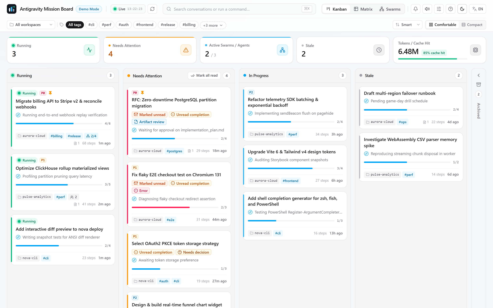
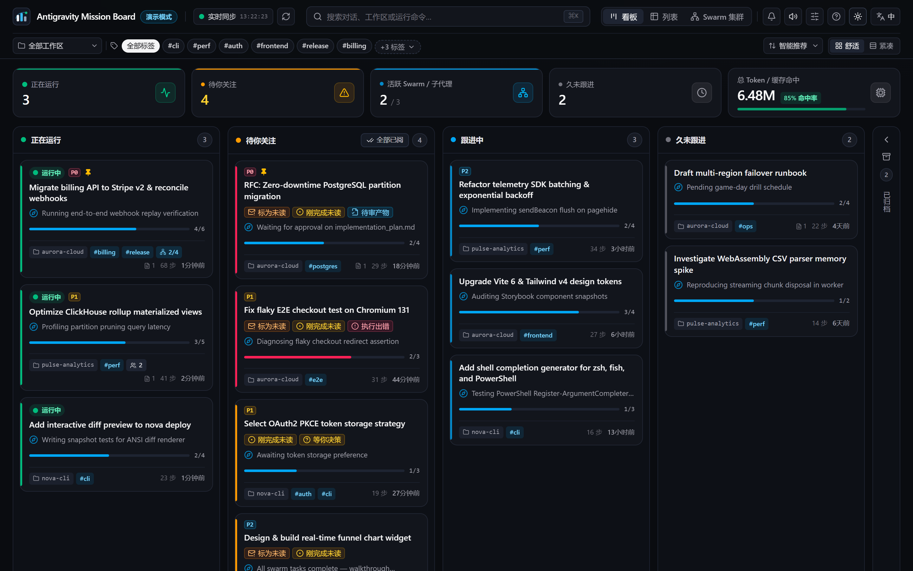
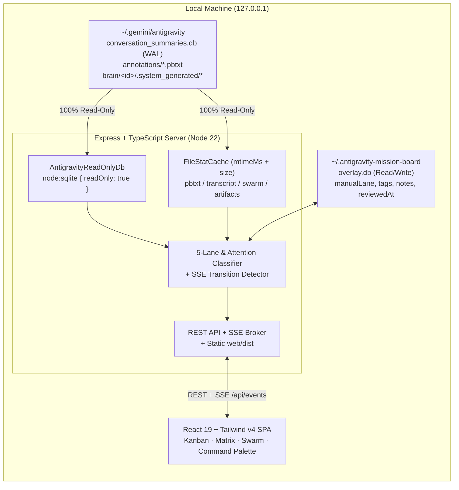

<div align="center">


<h1>Antigravity Mission Board</h1>

<p><strong>Turn <code>~/.gemini/antigravity</code> into a live, local-first Mission Control Kanban — never lose track of a background agent, Swarm, or unread completion again.</strong></p>

<p>
  <a href="https://github.com/Lovlace777/antigravity-mission-board/actions/workflows/ci.yml"></a>
  <a href="https://github.com/Lovlace777/antigravity-mission-board/releases/tag/v1.1.0"></a>
  <a href="https://nodejs.org/">= 22.5" /></a>
  <a href="https://nodejs.org/api/sqlite.html"></a>
  
  <a href="./LICENSE"></a>
</p>

<p>
  <strong>English</strong> · <a href="./README.zh-CN.md">简体中文</a>
</p>

<p>
  <a href="#try-it-in-10-seconds">Quick Start</a> ·
  <a href="#how-it-compares">How It Compares</a> ·
  <a href="#visual-feature-showcase">Visual Tour</a> ·
  <a href="#read-only-privacy--safety-pledge">Privacy &amp; Safety</a> ·
  <a href="#architecture">Architecture</a> ·
  <a href="#keyboard-shortcuts">Shortcuts</a>
</p>

<br />

<picture>
  <source media="(prefers-color-scheme: dark)" srcset="docs/screenshots/kanban-dark.png" />
  <source media="(prefers-color-scheme: light)" srcset="docs/screenshots/kanban-light.png" />
  
</picture>

<sub><em>All screenshots are captured from the built-in synthetic Demo Mode (<code>npm run start:demo</code>). Zero private data or real user conversations are ever included.</em></sub>

</div>

---

## Try It in 10 Seconds

Explore the full interactive dashboard immediately with realistic synthetic Swarms, subagents, checklists, and Markdown artifacts — **zero Antigravity installation or real data required**:

```bash
git clone https://github.com/Lovlace777/antigravity-mission-board.git
cd antigravity-mission-board
npm run setup && npm run build
npm run start:demo
```

Open **http://127.0.0.1:3777** — then switch to your real local `~/.gemini/antigravity` data (100% read-only) anytime:

| Platform | Live Mode (Real Antigravity Data) | Synthetic Demo Mode |
| --- | --- | --- |
| **Windows** | Double-click **`start.bat`** | `start.bat --demo` |
| **macOS / Linux** | **`./start.sh`** | `./start.sh --demo` |
| **Cross-platform CLI** | **`npm start`** | `npm run start:demo` |

> **Prerequisite:** Node.js **22.5+** (uses Node's built-in `node:sqlite` — no Python, no `node-gyp`, no Visual Studio C++ Build Tools).

---

## Why Mission Board?

Once you juggle 5–30 parallel **Google Antigravity Desktop 2.0** threads, multi-agent Swarms, and background subagents across repositories, linear sidebars collapse:

- **Silent completions:** An agent finished 20 minutes ago or paused on `ask_question` / `requestFeedback` — buried three folders down.
- **Hidden active Swarms:** The coordinator is parked in `waiting`, so the sidebar looks idle while two workers are actively building.
- **Zero triage ergonomics:** No priorities, no personal follow-up notes, no batch mark-read, and no way to spot workstreams going stale.

**Antigravity Mission Board** reads your existing Antigravity Desktop 2.0 SQLite WAL store, `.pbtxt` annotations, transcripts, Swarm files, and artifacts **strictly read-only**, classifies every root conversation into 5 live lanes, and layers your personal Kanban triage in an isolated local overlay database.

---

## How It Compares

| Capability | **Antigravity Mission Board** | Quota / Account Monitors | Static History Viewers | External CLI Orchestrators |
| --- | :---: | :---: | :---: | :---: |
| Passive support for existing Antigravity Desktop 2.0 sessions | ✅ | ✅ | ✅ | ❌ |
| 5-Lane Auto Kanban (`Running` / `Attention` / `In Progress` / `Stale` / `Archived`) + DnD | ✅ | ❌ | ❌ | ⚠️ Partial |
| Real-Time Attention Radar (`ask_question`, `requestFeedback`, unread, error, batch review + Undo) | ✅ | ❌ | ❌ | ❌ |
| Native Swarm `plan.json` threads, worker roster & board monitor | ✅ | ❌ | ❌ | ❌ |
| Floating `Ctrl+K` Command Palette, density toggle & keyboard triage | ✅ | ❌ | ❌ | ❌ |
| Zero C++ native deps on Windows/macOS/Linux (`node:sqlite` + FTS shadow fallback) | ✅ | ⚠️ Varies | ⚠️ Varies | ⚠️ Varies |
| 100% Read-Only on `~/.gemini/antigravity` & fully offline | ✅ | ✅ | ✅ | ❌ |

---

## Visual Feature Showcase

### 1. Floating Command Palette (`Ctrl+K` / `/`) & Instant Triage
Jump to any conversation via live local + full-text search, switch views, toggle themes or density, or clear all unread alerts without lifting your hands off the keyboard. Hovering any card reveals a 1-second Quick-Action Pill (`Pin` · `Cycle Priority` · `Mark Reviewed`), and every batch or drag-and-drop action includes instant **Undo**.



### 2. Slide-Over Detail Drawer & Rich Markdown Artifacts
Click any card to inspect live `update_steps` checklists (with automatic `transcript_full.jsonl` recovery when compact logs truncate), token & cache hit-rate breakdowns, chronological timelines, and rendered GFM Markdown artifacts (checklists, metrics tables, syntax-styled code fences). Personal tags, notes, and follow-up dates sit in a sleek 1-line expandable bar, with `←` / `→` keyboard triage across conversations.



### 3. Swarm & Multi-Agent Cluster Monitor
Track every active and completed Swarm in one dedicated workspace: inspect `plan.json` goals and thread assignments, live worker states (`working` / `waiting` / `stopped` / `killed` + model), board message feeds, and nested subagent trees.


### 4. High-Density Project Matrix View
Scanning 30+ conversations across repositories? Switch to **Project Matrix** (`2`) to group by workspace, tag, or lane and sort by recency, attention, priority, step count, or token usage with inline pinning and one-click review.



<details>
<summary><strong>More Screenshots: Light Mode &amp; Simplified Chinese UI (中文界面)</strong></summary>

<br />

#### Crisp Alabaster Light Mode


#### Bilingual Simplified Chinese UI (`中文` / `EN`)


</details>

---

## Read-Only Privacy & Safety Pledge

- **100% Read-Only on Antigravity Data:** `conversation_summaries.db` is opened exclusively with `new DatabaseSync(dbPath, { readOnly: true })` and `PRAGMA query_only = ON`, then closed immediately after each snapshot so Antigravity WAL checkpoints are never blocked. Mission Board **never writes, modifies, or deletes** any file inside `~/.gemini/antigravity`.
- **Isolated Local Overlay Store:** Your personal triage state (manual lanes, pins, priorities, custom tags, notes, reminders, `reviewedAt` timestamps, and settings) is stored separately in `~/.antigravity-mission-board/overlay.db`.
- **Localhost-Only & Zero Telemetry:** Binds strictly to `127.0.0.1:3777` by default with zero external network calls or analytics.
- **Hardened Artifact Reader:** `/api/conversations/:id/artifact` validates IDs, blocks `..`, absolute paths, Windows drive prefixes, `.system_generated` internal logs, and symlink escapes (`realpathSync` containment), and caps responses at 512 KB.
- **Universal Node 22 Compatibility:** Automatically falls back to SQLite's regular `conversations_fts_content` shadow table on Node 22.5–22.15 builds compiled without the FTS5 module — zero native addons required.

---

## Architecture



---

## Keyboard Shortcuts

| Shortcut | Action |
| --- | --- |
| `Ctrl+K` / `⌘K` / `/` | Open floating Command Palette (search + quick commands) |
| `1` / `2` / `3` | Switch between **Kanban**, **Project Matrix**, and **Swarm Clusters** |
| `←` / `→` | Navigate previous / next conversation while Detail Drawer is open |
| `R` | Refresh board snapshot immediately |
| `?` | Open Keyboard Shortcuts cheatsheet |
| `Esc` | Close Command Palette, Detail Drawer, or modal |

---

<details>
<summary><strong>Environment Variables</strong></summary>

| Variable | Default | Description |
| --- | --- | --- |
| `PORT` | `3777` | HTTP listen port |
| `HOST` | `127.0.0.1` | Bind address (keep `127.0.0.1` for local-only access) |
| `ANTIGRAVITY_DATA_DIR` | `~/.gemini/antigravity` | Override Antigravity Desktop 2.0 local data directory |
| `OVERLAY_DB_PATH` | `~/.antigravity-mission-board/overlay.db` | Override Mission Board local overlay SQLite path |
| `DEMO_MODE` | `0` | Set to `1` or `true` (or pass `--demo`) to run with the synthetic demo dataset |

</details>

<details>
<summary><strong>REST &amp; SSE API Reference</strong></summary>

All endpoints are served under `http://127.0.0.1:3777`:

| Endpoint | Description |
| --- | --- |
| `GET /api/health` | Runtime mode (`live` \| `demo`), version (`1.1.0`), data directory & DB accessibility, uptime |
| `GET /api/board` | Full board snapshot: root `ConversationCard[]`, `stats`, `workspaces`, `projects`, `tags`, `settings`, `activeSwarms` |
| `GET /api/conversations/:id` | Detailed `ConversationDetail` (checklist, Swarm detail & board feed, recursive subagent tree, artifacts, timeline, tokens) |
| `GET /api/conversations/:id/artifact?file=...` | Path-traversal-safe artifact Markdown/text reader (max 512 KB) |
| `PATCH /api/conversations/:id/overlay` | Update `manualLane`, `pinned`, `priority`, `tags`, `notes`, `followUpAt`, or `reviewedAt` |
| `POST /api/conversations/:id/review` | Set `reviewedAt = now` to clear pending attention alerts for one conversation |
| `POST /api/conversations/review-batch` | Batch update `reviewedAt` for up to 200 conversation IDs (supports `reviewedAt: null` for Undo) |
| `GET /api/search?q=...` | Full-text search across transcripts (FTS5 / shadow fallback), titles, previews, tags, and notes |
| `GET /api/settings` · `PATCH /api/settings` | Read or update `staleAfterHours` and `pollIntervalMs` |
| `GET /api/events` | Server-Sent Events stream (`connected`, `heartbeat`, snapshot-diff `board_update`, semantic `notification`) |

</details>

<details>
<summary><strong>Development &amp; Testing Commands</strong></summary>

```bash
npm run dev        # Run backend (tsx watch) + frontend (Vite HMR) together
npm run dev:demo   # Run dev servers against synthetic Demo Mode
npm run typecheck  # Strict TypeScript check across server + web
npm test           # Run backend Vitest unit + API + security test suite
npm run build      # Production build (server tsc + web vite build)
```

</details>

---

## Contributing & License

Contributions, bug reports, and feature ideas are warmly welcome — see [CONTRIBUTING.md](./CONTRIBUTING.md) to get started.

Licensed under the [MIT License](./LICENSE).
