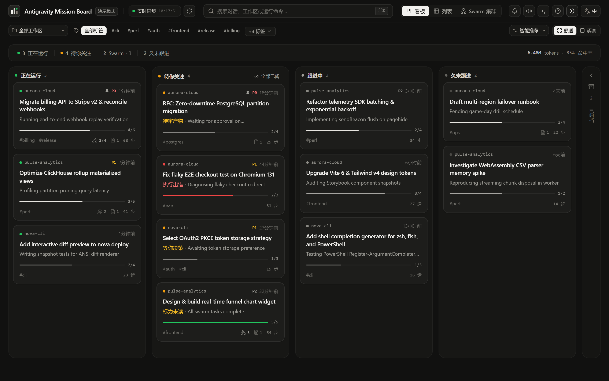
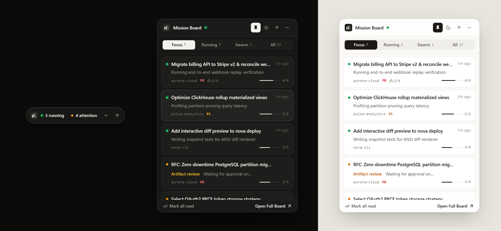
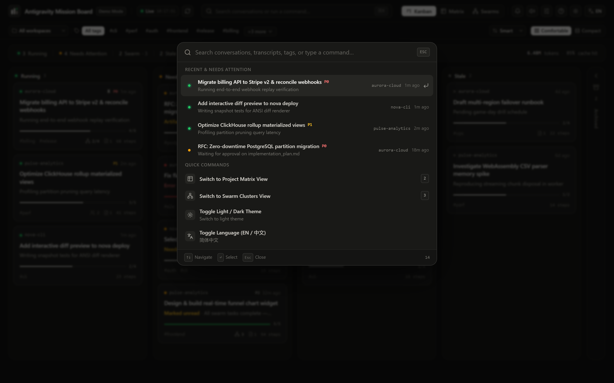
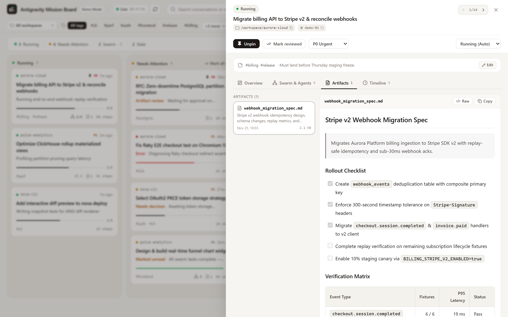
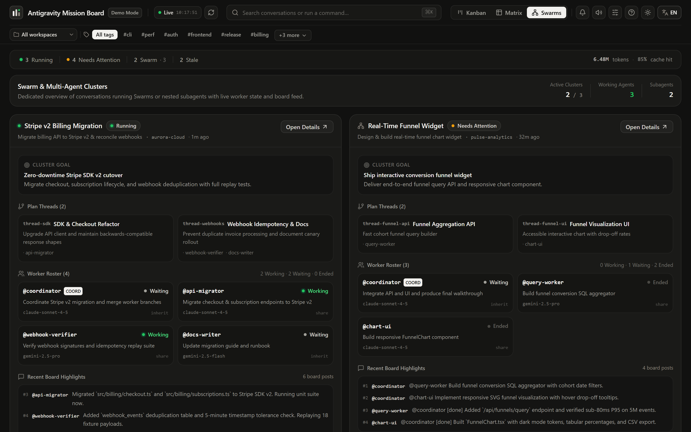
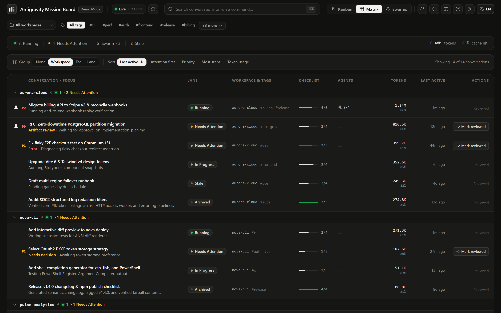
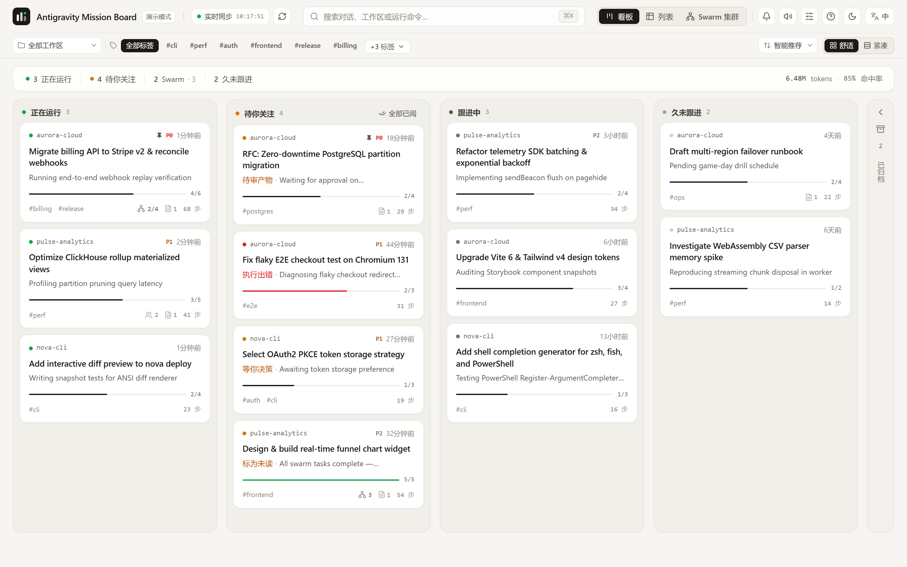
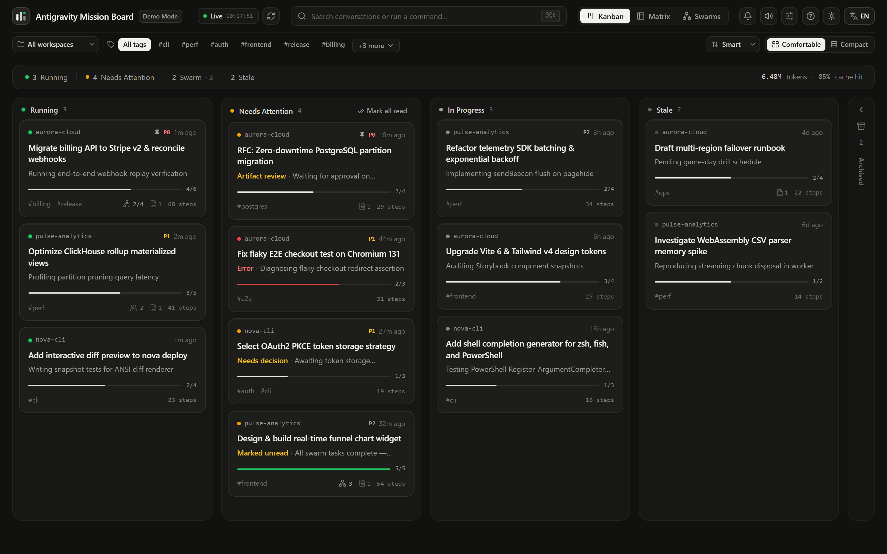
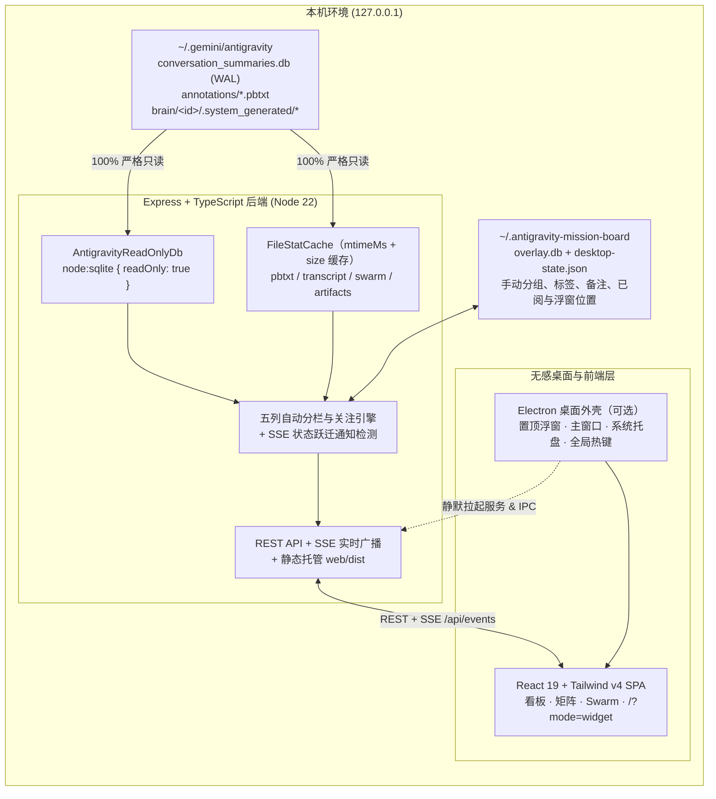

<div align="center">


<h1>Antigravity Mission Board</h1>

<p><strong>专为 Google Antigravity Desktop 2.0 打造的极简编辑感任务看板与桌面置顶浮窗 —— 无黑框后台常驻、零 C++ 编译依赖、对原数据 100% 只读。</strong></p>

<p>
  <a href="https://github.com/Lovlace777/antigravity-mission-board/actions/workflows/ci.yml"></a>
  <a href="https://github.com/Lovlace777/antigravity-mission-board/releases/tag/v2.0.0"></a>
  
  <a href="https://nodejs.org/">= 22.5" /></a>
  <a href="https://nodejs.org/api/sqlite.html"></a>
  
  <a href="./LICENSE"></a>
</p>

<p>
  <a href="./README.md">English</a> · <strong>简体中文</strong>
</p>

<p>
  <a href="#%E5%BF%AB%E9%80%9F%E4%B8%8A%E6%89%8B">快速上手</a> ·
  <a href="#%E6%A0%B8%E5%BF%83%E4%BD%93%E9%AA%8C%E4%B8%8E%E9%AB%98%E6%B8%85%E5%9B%BE%E9%9B%86">高清图集</a> ·
  <a href="#%E4%B8%8E%E5%90%8C%E7%B1%BB%E5%B7%A5%E5%85%B7%E5%AF%B9%E6%AF%94">横向对比</a> ·
  <a href="#100-%E5%8F%AA%E8%AF%BB%E4%B8%8E%E9%9A%90%E7%A7%81%E5%AE%89%E5%85%A8%E6%89%BF%E8%AF%BA">隐私安全承诺</a> ·
  <a href="#%E7%B3%BB%E7%BB%9F%E6%9E%B6%E6%9E%84">架构设计</a> ·
  <a href="#%E5%BF%AB%E6%8D%B7%E9%94%AE%E4%B8%8E%E5%B8%B8%E8%A7%81%E9%97%AE%E9%A2%98">快捷键与 FAQ</a>
</p>

<br />

<picture>
  <source media="(prefers-color-scheme: dark)" srcset="docs/screenshots/kanban-zh-dark.png" />
  <source media="(prefers-color-scheme: light)" srcset="docs/screenshots/kanban-zh-light.png" />
  
</picture>

<sub><em>本仓库所有截图均基于内置合成演示模式（<code>npm run start:demo</code> / <code>npm run desktop:demo</code>）生成，绝不包含任何个人隐私或真实对话数据。</em></sub>

</div>

---

## 快速上手

> **环境要求：** 仅需 **Node.js 22.5+**（使用内置 `node:sqlite`，Windows / macOS / Linux 均无需 Python、`node-gyp` 或 Visual Studio C++ 构建工具）。

### 方式一：无缝桌面端 + 置顶浮窗 *（推荐，彻底告别黑框终端）*

无感驻留系统托盘的 **灵动岛式置顶桌面浮窗** + **原生完整看板窗口**，支持全局快捷键随时呼出（`Ctrl+Shift+W` / `Ctrl+Shift+M`）与开机自启，彻底告别手动点开并挂着 `start.bat` 黑框：

```bash
git clone https://github.com/Lovlace777/antigravity-mission-board.git
cd antigravity-mission-board
npm run setup && npm run setup:desktop && npm run build

# 启动真实只读模式（直连 ~/.gemini/antigravity）
npm run desktop

# 或先用内置合成演示数据零风险体验
npm run desktop:demo
```

**Windows 一键安装桌面快捷方式（双击直启，全程零 CMD 窗口）：**
```bash
# 在桌面与开始菜单创建原生图标快捷方式
npm run desktop:install

# 如需同时开启「开机自动启动」：
powershell -ExecutionPolicy Bypass -File desktop/scripts/install-windows-shortcut.ps1 -EnableAutoStart
```

### 方式二：轻量无黑框 Web 模式 *（无需安装 Electron）*

如果你习惯直接在浏览器里查看，同样可以无感静默启动：

| 平台 | 真实只读模式（连接本机 Antigravity） | 合成演示模式（10 秒零风险体验） |
| --- | --- | --- |
| **Windows（推荐 · 零黑框）** | 直接双击 **`start-silent.vbs`** | `wscript start-silent.vbs --demo` |
| **Windows（终端日志模式）** | 双击 **`start.bat`** | `start.bat --demo` |
| **macOS / Linux** | **`./start.sh`** | `./start.sh --demo` |
| **通用命令行** | **`npm start`** | `npm run start:demo` |

浏览器会自动打开 **http://127.0.0.1:3777**，即刻接管全部后台任务视野。

---

## 核心体验与高清图集

### 1. 桌面置顶浮窗 + 系统托盘无感常驻
轻轻停靠在屏幕一角，不抢焦点、不留终端黑框，写代码或看网页时余光就能掌握所有 Agent 动态：
- **折叠胶囊态（`276×56`）：** 温润黑曜石 / 暖纸质胶囊，常驻呼吸绿点显示 `3 运行中 · 4 待关注`（全部处理完毕时转为安静的 `✓ 一切正常`），任意拖动并自动记住停靠位置。
- **展开速览面板（`392×540`）：** 内置 `焦点 / 运行中 / Swarm / 全部` 分栏、极细 `2px` 进度条、悬停一键「已阅」与**撤销（Undo）**、明暗切换、置顶开关；点击任意条目直接唤醒完整看板并定位到对应详情抽屉。
- **系统托盘与全局热键：** 关闭主窗口自动隐藏到托盘后台运行；随时按 `Ctrl+Shift+W` 显隐浮窗、`Ctrl+Shift+M` 呼出完整看板，并可在托盘菜单或设置面板一键开关**开机自动启动**。



### 2. 去 AI 化温润编辑感设计 + `Ctrl+K` 浮动命令面板
彻底告别刺眼的赛博蓝黑、彩虹左边框与堆叠胶囊；以 Things 3 / Linear / Dieter Rams 的暖石纸面（`#F6F5F1`）与暖黑曜石（`#111110`）重构视觉层次。按下 `Ctrl+K` 或 `/` 即刻呼出浮动命令面板，支持本地 + 全文检索直达对话与键盘执行所有快捷操作；拖拽换栏与一键「全部已阅」均自带右下角 **撤销（Undo）**。



### 3. 右侧详情抽屉与 Markdown 产物在线审阅
点击卡片即可查看实时 `update_steps` 任务清单（自动兼容精简日志截断并回退读取 `transcript_full.jsonl`）、Token 消耗与缓存命中率、完整时间线，以及精排 GFM Markdown 产物预览（复选框清单、对比指标表、代码块）。个人标签与备注默认折叠为清爽的单行摘要栏，并支持 `←` / `→` 连续巡检上一条 / 下一条对话。



### 4. Swarm 集群与多智能体监控台
集中呈现每个 Swarm 的 `plan.json` 目标与线程拆解、所有 Worker 的实时状态（`working` / `waiting` / `stopped` / `killed` 及所用模型）、讨论板动态与递归子代理树。



### 5. 高密度项目矩阵视图
跨仓库同时管理 30+ 对话时，按 `2` 切换至高密度矩阵视图：按工作区、自定义标签或泳道分组，按最近活跃、关注度、优先级、步数或 Token 排序，几秒钟完成全局盘点。



<details>
<summary><strong>更多截图：暖纸面浅色模式 &amp; 英文界面</strong></summary>

<br />

#### 暖纸面中文浅色看板


#### 英文浅色模式看板


#### 英文深色模式看板（顶栏一键中英切换）


</details>

---

## 与同类工具对比

| 能力 | **Antigravity Mission Board** | 额度 / 账号监控插件 | 静态历史查看器 | 外部 CLI 编排器 |
| --- | :---: | :---: | :---: | :---: |
| 桌面置顶浮窗 + 无黑框系统托盘常驻与开机自启 | ✅ | ❌ | ❌ | ❌ |
| 原生被动监控已有 Antigravity Desktop 2.0 会话 | ✅ | ✅ | ✅ | ❌ |
| 五列自动看板（运行中 / 待关注 / 跟进中 / 久未跟进 / 已归档）+ 拖拽 | ✅ | ❌ | ❌ | ⚠️ 部分 |
| 实时关注雷达（未读完成、提问卡点、报错、待审文档、批量已阅 + 撤销） | ✅ | ❌ | ❌ | ❌ |
| 原生 Swarm `plan.json` 线程、成员状态与讨论板监控 | ✅ | ❌ | ❌ | ❌ |
| `Ctrl+K` 浮动命令面板、卡片密度切换与键盘极速巡检 | ✅ | ❌ | ❌ | ❌ |
| Windows 零 C++ 编译依赖（内置 `node:sqlite` + FTS 影子表兼容） | ✅ | ⚠️ 视实现 | ⚠️ 视实现 | ⚠️ 视实现 |
| 对 `~/.gemini/antigravity` 100% 只读且完全离线 | ✅ | ✅ | ✅ | ❌ |

---

## 100% 只读与隐私安全承诺

- **对 Antigravity 数据绝不写入一个字节：** `conversation_summaries.db` 严格通过 `new DatabaseSync(dbPath, { readOnly: true })` 与 `PRAGMA query_only = ON` 打开，每次读取完立即关闭句柄，绝不阻塞 Antigravity 自身的 SQLite WAL 检查点。
- **个人标注完全隔离存储：** 你的手动分组、置顶、优先级、标签、跟进备注、提醒日期、`reviewedAt` 以及浮窗停靠位置均单独保存在 `~/.antigravity-mission-board/`。
- **仅监听本机回环、零遥测：** 默认绑定 `127.0.0.1:3777`，不向任何外部服务器上报数据。
- **产物接口防目录穿越：** `/api/conversations/:id/artifact` 严格校验对话 ID、拦截 `..` / 绝对路径 / Windows 盘符 / `.system_generated` 内部目录与符号链接越界，并限制单文件最大读取 512 KB。
- **完美适配中文路径与所有 Node 22 版本：** 完整支持中文 Windows 用户名路径及 `.pbtxt` 八进制 UTF-8 标题解码；在未编入 FTS5 模块的 Node 22.5–22.15 环境中自动回退读取 `conversations_fts_content` 影子表。

---

## 系统架构



---

## 快捷键与常见问题

| 范围 | 快捷键 | 功能 |
| --- | --- | --- |
| **全局热键（桌面端）** | `Ctrl+Shift+W` / `⌘⇧W` | 显示 / 隐藏桌面置顶浮窗 |
| **全局热键（桌面端）** | `Ctrl+Shift+M` / `⌘⇧M` | 呼出 / 聚焦完整任务看板窗口 |
| **应用内** | `Ctrl+K` / `⌘K` / `/` | 打开浮动命令面板（全局搜索 + 快捷命令） |
| **应用内** | `1` / `2` / `3` | 快速切换 **看板** / **项目矩阵** / **Swarm 集群** 视图 |
| **应用内** | `←` / `→` | 在打开详情抽屉时切换上一条 / 下一条对话 |
| **应用内** | `R` | 立即刷新最新看板数据 |
| **应用内** | `?` | 打开快捷键速查表 |
| **应用内** | `Esc` | 关闭命令面板、详情抽屉或弹窗 |

<details>
<summary><strong>常见问题 (FAQ)</strong></summary>

- **Q：使用桌面浮窗时，关闭主窗口会杀掉后台监控吗？**  
  不会。点击主窗口右上角 `×` 会自动最小化到系统托盘，置顶浮窗与实时监听继续在后台无感运行；如需彻底退出，右键系统托盘图标选择「退出 (Quit)」即可干净关闭所有进程。
- **Q：Windows 用户名包含中文会乱码或报错吗？**  
  不会。后端完整支持 Unicode Windows 路径解码，并内置支持 UTF-8 八进制转义（如 `\344\270\255`）的 `.pbtxt` 解析器，中文路径与中文对话标题均可准确显示。
- **Q：为什么在看板或浮窗点击「已阅」后，Antigravity 客户端里的未读红点没有消失？**  
  这是刻意遵守 **100% 只读** 原则的安全设计。看板会在独立的 `~/.antigravity-mission-board/overlay.db` 中记录 `reviewedAt`，只要该对话此后没有新进展，就会保持已阅状态，并支持一键撤销。

</details>

<details>
<summary><strong>环境变量配置</strong></summary>

| 环境变量 | 默认值 | 说明 |
| --- | --- | --- |
| `PORT` | `3777` | HTTP 监听端口 |
| `HOST` | `127.0.0.1` | 绑定地址（建议保持 `127.0.0.1` 仅本机访问） |
| `ANTIGRAVITY_DATA_DIR` | `~/.gemini/antigravity` | 自定义 Antigravity Desktop 2.0 数据目录 |
| `OVERLAY_DB_PATH` | `~/.antigravity-mission-board/overlay.db` | 自定义 Mission Board 个人标注数据库路径 |
| `DEMO_MODE` | `0` | 设为 `1` 或 `true`（或传入 `--demo`）启用合成演示模式 |

</details>

<details>
<summary><strong>REST &amp; SSE API 参考</strong></summary>

| 接口 | 用途 |
| --- | --- |
| `GET /api/health` | 运行模式（`live` / `demo`）、版本（`2.0.0`）、数据目录与数据库可读状态 |
| `GET /api/board` | 获取完整看板快照：根对话卡片、统计指标、工作区、标签、设置与活跃 Swarm |
| `GET /api/conversations/:id` | 获取单个对话详情（步骤清单、Swarm 讨论板、子代理树、产物、时间线、Token） |
| `GET /api/conversations/:id/artifact?file=...` | 防目录穿越的 Markdown/文本产物读取接口（上限 512 KB） |
| `PATCH /api/conversations/:id/overlay` | 更新手动泳道、置顶、优先级、标签、备注、提醒日期或已阅时间 |
| `POST /api/conversations/:id/review` | 单条标为已阅（`reviewedAt = now`） |
| `POST /api/conversations/review-batch` | 批量标为已阅（最多 200 条，传入 `reviewedAt: null` 支持撤销） |
| `GET /api/search?q=...` | 全文检索（FTS5 / 影子表自动回退）+ 标题、预览、标签与备注搜索 |
| `GET /api/settings` · `PATCH /api/settings` | 读取或修改久未跟进阈值（`staleAfterHours`）与轮询间隔（`pollIntervalMs`） |
| `GET /api/events` | SSE 实时推送流（`connected`、`heartbeat`、`board_update`、`notification`） |

</details>

<details>
<summary><strong>本地开发、桌面端与打包命令</strong></summary>

```bash
npm run dev               # 同时启动后端热重载与 Vite 前端开发服
npm run dev:demo          # 以演示数据启动开发环境
npm run desktop           # 启动桌面置顶浮窗 + 系统托盘（真实只读模式）
npm run desktop:demo      # 以合成演示数据启动桌面端与浮窗
npm run desktop:install   # 创建 Windows 桌面与开始菜单无黑框快捷方式
npm run desktop:uninstall # 移除 Windows 快捷方式与开机自启项
npm run desktop:dist      # 使用 electron-builder 打包独立桌面安装包
npm run desktop:check     # 桌面端脚本零下载快速语法检查
npm run typecheck         # 前后端全量 TypeScript 类型检查
npm test                  # 运行后端 Vitest 单元、接口与安全测试
npm run build             # 构建前后端生产产物
```

</details>

---

## 参与贡献与开源协议

欢迎提交 Issue、建议新特性或发起 Pull Request，请参阅 [CONTRIBUTING.md](./CONTRIBUTING.md)。

本项目基于 [MIT License](./LICENSE) 开源。
