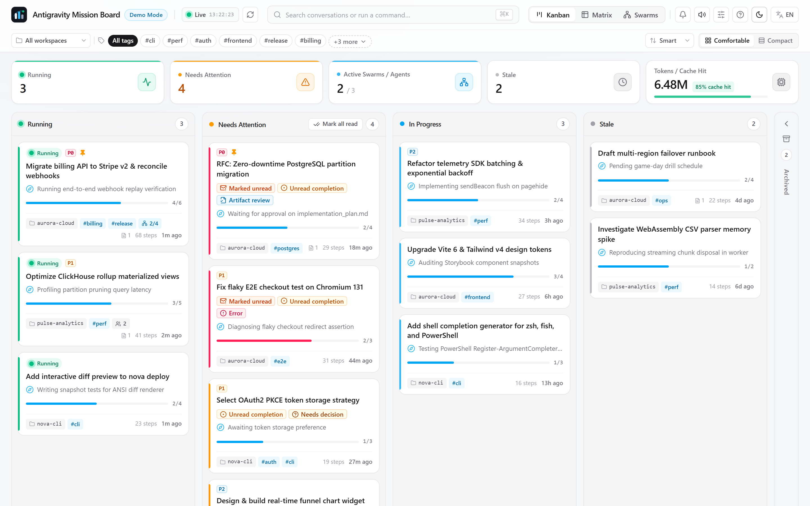

<div align="center">


<h1>Antigravity Mission Board</h1>

<p><strong>把 <code>~/.gemini/antigravity</code> 变成实时、本地优先的多智能体任务看板 —— 正在运行的 Agent、Swarm 集群、刚完成未读与待审计划，一屏全掌控。</strong></p>

<p>
  <a href="https://github.com/Lovlace777/antigravity-mission-board/actions/workflows/ci.yml"></a>
  <a href="https://github.com/Lovlace777/antigravity-mission-board/releases/tag/v1.1.0"></a>
  <a href="https://nodejs.org/">= 22.5" /></a>
  <a href="https://nodejs.org/api/sqlite.html"></a>
  
  <a href="./LICENSE"></a>
</p>

<p>
  <a href="./README.md">English</a> · <strong>简体中文</strong>
</p>

<p>
  <a href="#10-%E7%A7%92%E9%9B%B6%E9%A3%8E%E9%99%A9%E4%BD%93%E9%AA%8C">10 秒体验</a> ·
  <a href="#%E4%B8%8E%E5%90%8C%E7%B1%BB%E5%B7%A5%E5%85%B7%E5%AF%B9%E6%AF%94">横向对比</a> ·
  <a href="#%E6%A0%B8%E5%BF%83%E4%BD%93%E9%AA%8C%E4%B8%8E%E9%AB%98%E6%B8%85%E5%9B%BE%E9%9B%86">高清图集</a> ·
  <a href="#100-%E5%8F%AA%E8%AF%BB%E4%B8%8E%E9%9A%90%E7%A7%81%E5%AE%89%E5%85%A8%E6%89%BF%E8%AF%BA">隐私安全承诺</a> ·
  <a href="#%E7%B3%BB%E7%BB%9F%E6%9E%B6%E6%9E%84">架构设计</a> ·
  <a href="#%E5%BF%AB%E6%8D%B7%E9%94%AE%E4%B8%8E%E5%B8%B8%E8%A7%81%E9%97%AE%E9%A2%98">快捷键与 FAQ</a>
</p>

<br />

<picture>
  <source media="(prefers-color-scheme: dark)" srcset="docs/screenshots/kanban-zh-dark.png" />
  <source media="(prefers-color-scheme: light)" srcset="docs/screenshots/kanban-light.png" />
  
</picture>

<sub><em>本仓库所有截图均基于内置合成演示模式（<code>npm run start:demo</code>）生成，绝不包含任何个人隐私或真实对话数据。</em></sub>

</div>

---

## 为什么你会在多任务并行时迷路？

当你同时在 **Google Antigravity Desktop 2.0** 里开着 5～30 个跨项目对话、Swarm 多智能体协作与后台子代理时，传统线性侧边栏很快就会失控：

- **悄无声息跑完或卡住：** Agent 20 分钟前就完成了任务，或者触发了 `ask_question` / `requestFeedback` 等你拍板，却被埋在历史列表里。
- **看不出 Swarm 还在干活：** Coordinator 在等 Worker 回报，表面看似空闲，底层其实正有两三个 Worker 在并发改代码。
- **缺少日常排期与跟进手段：** 没有优先级、置顶、自定义标签、批量已阅，也不知道哪些老任务已经一周没动。

**Antigravity Mission Board** 以 **100% 只读** 方式直接解析本地 `~/.gemini/antigravity` 数据库、`.pbtxt` 标注、对话日志、Swarm 状态与产物文件，自动将所有根对话分入 5 条任务泳道，并把你的个人标注保存在独立的本地 SQLite 中。

---

## 与同类工具对比

| 能力 | **Antigravity Mission Board** | 额度 / 账号监控插件 | 静态历史查看器 | 外部 CLI 编排器 |
| --- | :---: | :---: | :---: | :---: |
| 原生被动监控已有 Antigravity Desktop 2.0 会话 | ✅ | ✅ | ✅ | ❌ |
| 五列自动看板（运行中 / 待关注 / 跟进中 / 久未跟进 / 已归档）+ 拖拽 | ✅ | ❌ | ❌ | ⚠️ 部分 |
| 实时关注雷达（未读完成、提问卡点、报错、待审文档、批量已阅 + 撤销） | ✅ | ❌ | ❌ | ❌ |
| 原生 Swarm `plan.json` 线程、成员状态与讨论板监控 | ✅ | ❌ | ❌ | ❌ |
| `Ctrl+K` 浮动命令面板、卡片密度切换与键盘极速巡检 | ✅ | ❌ | ❌ | ❌ |
| Windows 零 C++ 编译依赖（内置 `node:sqlite` + FTS 影子表兼容） | ✅ | ⚠️ 视实现 | ⚠️ 视实现 | ⚠️ 视实现 |
| 对 `~/.gemini/antigravity` 100% 只读且完全离线 | ✅ | ✅ | ✅ | ❌ |

---

## 10 秒零风险体验

无需安装 Antigravity、不碰本机任何真实数据，立即体验包含 3 个项目、14 条对话、2 个多智能体 Swarm、任务清单与 Markdown 产物的完整演示模式：

```bash
git clone https://github.com/Lovlace777/antigravity-mission-board.git
cd antigravity-mission-board
npm run setup && npm run build
npm run start:demo
```

浏览器打开 **http://127.0.0.1:3777**。体验满意后，随时一键切回你自己的真实 Antigravity 数据（严格只读）：

| 平台 | 真实只读模式（连接本机 Antigravity） | 合成演示模式（Demo） |
| --- | --- | --- |
| **Windows（推荐）** | 直接双击 **`start.bat`**（自动装依赖、构建并打开浏览器） | `start.bat --demo` |
| **macOS / Linux** | 运行 **`./start.sh`** | `./start.sh --demo` |
| **通用命令** | **`npm start`** | `npm run start:demo` |

> **环境要求：** 仅需 **Node.js 22.5+**（使用内置 `node:sqlite`，彻底告别 `node-gyp` 与 Visual Studio C++ 构建工具报错）。

---

## 核心体验与高清图集

### 1. `Ctrl+K` 浮动命令面板与一秒分拣
按下 `Ctrl+K` / `/` 即可唤出居中毛玻璃命令面板，支持本地 + 全文检索直达对话，也能直接执行视图切换、主题切换、紧凑模式、一键全部已阅等快捷操作。看板卡片悬停即现快捷操作胶囊（置顶 / 切优先级 / 标为已阅），拖拽分栏与批量已阅均提供右下角 **撤销（Undo）** 浮窗。


### 2. 右侧详情抽屉与 Markdown 产物在线审阅
点开任意卡片即可查看实时 `update_steps` 任务清单（自动兼容精简日志截断并回退读取 `transcript_full.jsonl`）、Token 消耗与缓存命中率、完整对话时间线，以及美观排版的 GFM Markdown 产物预览（任务复选框、对比表格、代码块）。个人备注与标签默认收起为单行摘要栏，并支持 `←` / `→` 连续巡检上一条 / 下一条对话。


### 3. Swarm 集群与多智能体监控台
专为多智能体协同打造：清晰展示 `plan.json` 目标与线程拆解、每位成员的实时状态（`working` / `waiting` / `stopped` / `killed`）与所用模型、讨论板动态以及递归子代理树。


### 4. 高密度项目矩阵视图
当项目和对话超过 30 个时，按 `2` 切换至高密度矩阵视图：按工作区、自定义标签或泳道分组，按活跃时间、关注度、优先级、步数或 Token 排序，几秒钟完成全局盘点。


<details>
<summary><strong>更多截图：清爽浅色模式 &amp; 英文深色看板</strong></summary>

<br />

#### 浅色模式看板


#### 英文深色看板（一键中英切换）


</details>

---

## 100% 只读与隐私安全承诺

- **对 Antigravity 数据绝不写入一个字节：** `conversation_summaries.db` 严格通过 `new DatabaseSync(dbPath, { readOnly: true })` 与 `PRAGMA query_only = ON` 打开，每次读取完立即关闭句柄，绝不阻塞 Antigravity 自身的 SQLite WAL 检查点。
- **个人标注完全隔离存储：** 你的手动分组、置顶、优先级、标签、跟进备注、提醒日期与 `reviewedAt` 均单独保存在 `~/.antigravity-mission-board/overlay.db`。
- **仅监听本机回环、零遥测：** 默认绑定 `127.0.0.1:3777`，不发任何外部网络请求。
- **产物接口防目录穿越：** `/api/conversations/:id/artifact` 严格校验对话 ID、拦截 `..` / 绝对路径 / Windows 盘符 / `.system_generated` 内部目录与符号链接越界，并限制单文件最大读取 512 KB。
- **完美适配中文路径与所有 Node 22 版本：** 完整支持中文 Windows 用户名路径及 `.pbtxt` 八进制 UTF-8 标题解码；在未编入 FTS5 模块的 Node 22.5–22.15 环境中自动平滑回退到 `conversations_fts_content` 影子表。

---

## 系统架构


---

## 快捷键与常见问题

| 快捷键 | 功能 |
| --- | --- |
| `Ctrl+K` / `⌘K` / `/` | 打开浮动命令面板（全局检索 + 快捷命令） |
| `1` / `2` / `3` | 快速切换 **看板** / **项目矩阵** / **Swarm 集群** 视图 |
| `←` / `→` | 在打开详情抽屉时切换上一条 / 下一条对话 |
| `R` | 立即刷新最新看板数据 |
| `?` | 打开快捷键速查表 |
| `Esc` | 关闭命令面板、详情抽屉或弹窗 |

<details>
<summary><strong>常见问题 (FAQ)</strong></summary>

- **Q：Windows 用户名包含中文会乱码或报错吗？**  
  不会。后端完整支持 Unicode Windows 路径解码，并内置支持 UTF-8 八进制转义（如 `\344\270\255`）的 `.pbtxt` 解析器，中文路径与中文对话标题均可准确显示。
- **Q：为什么在看板点击「标为已阅」后，Antigravity 客户端里的未读红点没有消失？**  
  这是刻意遵守 **100% 只读** 原则的安全设计。看板会在独立的 `~/.antigravity-mission-board/overlay.db` 中记录 `reviewedAt`，只要该对话此后没有新进展，就会在看板里保持已阅状态，且支持一键撤销。
- **Q：提示 `ExperimentalWarning: SQLite is an experimental feature` 怎么办？**  
  这是 Node 22 内置 `node:sqlite` 的常规提示，`npm start`、`start.bat` 与 `start.sh` 已默认传入 `--no-warnings=ExperimentalWarning`，可安心使用。

</details>

<details>
<summary><strong>环境变量配置</strong></summary>

| 环境变量 | 默认值 | 说明 |
| --- | --- | --- |
| `PORT` | `3777` | HTTP 监听端口 |
| `HOST` | `127.0.0.1` | 绑定地址（建议保持 `127.0.0.1` 仅本机访问） |
| `ANTIGRAVITY_DATA_DIR` | `~/.gemini/antigravity` | 自定义 Antigravity Desktop 2.0 数据目录 |
| `OVERLAY_DB_PATH` | `~/.antigravity-mission-board/overlay.db` | 自定义 Mission Board 个人标注数据库路径 |
| `DEMO_MODE` | `0` | 设为 `1` 或 `true`（或传入 `--demo`）启用合成演示模式 |

</details>

<details>
<summary><strong>REST &amp; SSE API 参考</strong></summary>

| 接口 | 用途 |
| --- | --- |
| `GET /api/health` | 运行模式（`live` / `demo`）、版本（`1.1.0`）、数据目录与数据库可读状态 |
| `GET /api/board` | 获取完整看板快照：根对话卡片、统计指标、工作区、标签、设置与活跃 Swarm |
| `GET /api/conversations/:id` | 获取单个对话详情（步骤清单、Swarm 讨论板、子代理树、产物、时间线、Token） |
| `GET /api/conversations/:id/artifact?file=...` | 防目录穿越的 Markdown/文本产物读取接口（上限 512 KB） |
| `PATCH /api/conversations/:id/overlay` | 更新手动泳道、置顶、优先级、标签、备注、提醒日期或已阅时间 |
| `POST /api/conversations/:id/review` | 单条标为已阅（`reviewedAt = now`） |
| `POST /api/conversations/review-batch` | 批量标为已阅（最多 200 条，传入 `reviewedAt: null` 支持撤销） |
| `GET /api/search?q=...` | 全文检索（FTS5 / 影子表自动回退）+ 标题、预览、标签与备注搜索 |
| `GET /api/settings` · `PATCH /api/settings` | 读取或修改久未跟进阈值（`staleAfterHours`）与轮询间隔（`pollIntervalMs`） |
| `GET /api/events` | SSE 实时推送流（`connected`、`heartbeat`、`board_update`、`notification`） |

</details>

<details>
<summary><strong>本地开发与测试命令</strong></summary>

```bash
npm run dev        # 同时启动后端热重载与 Vite 前端开发服
npm run dev:demo   # 以演示数据启动开发环境
npm run typecheck  # 前后端全量 TypeScript 类型检查
npm test           # 运行后端 Vitest 单元、接口与安全测试
npm run build      # 构建前后端生产产物
```

</details>

---

## 参与贡献与开源协议

欢迎提交 Issue、建议新特性或发起 Pull Request，请参阅 [CONTRIBUTING.md](./CONTRIBUTING.md)。

本项目基于 [MIT License](./LICENSE) 开源。
