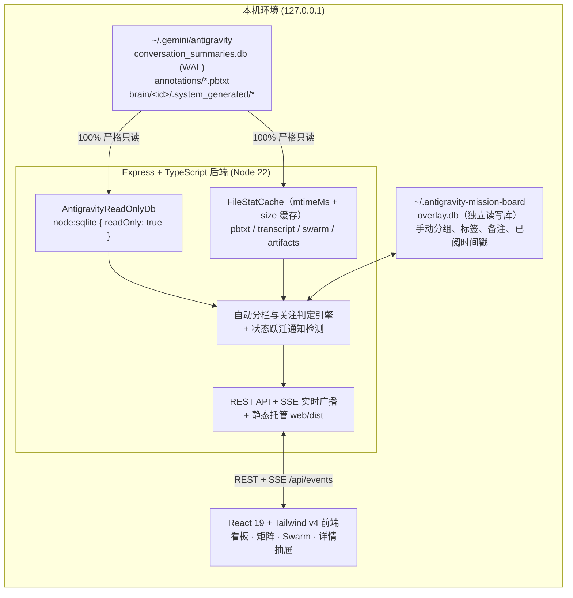

<div align="center">

# Antigravity Mission Board

**专为 Google Antigravity Desktop 2.0 打造的本地优先看板与多智能体任务监控台**

一站式追踪正在运行的 Agent、刚完成未读的对话、待确认计划与决策、Swarm 集群、子代理树、任务清单、产物文档与 Token 消耗 —— 对 Antigravity 本地数据 **100% 只读**，且 **零原生 C++ 编译依赖**。

[](https://github.com/Lovlace777/antigravity-mission-board/actions/workflows/ci.yml)
[](https://nodejs.org/)
[](https://www.typescriptlang.org/)
[-0F766E)](https://nodejs.org/api/sqlite.html)
[](./LICENSE)

[English](./README.md) · **简体中文**

</div>


> *本仓库展示的所有截图均来自内置的合成演示模式（`npm run start:demo`），不包含任何个人隐私或真实工作区数据。*

---

## 为什么需要它？

当你同时在 Google Antigravity Desktop 2.0 中并行推进多个项目、多智能体 Swarm 和后台子代理时，往往很难一眼掌握全局：

- 哪些对话**此刻正在执行**（包括 Coordinator 处于等待、但底层 Worker 正在工作的 Swarm）？
- 哪些任务**刚刚完成还没来得及看**、遇到了**执行报错**、卡在 **`ask_question` 等你决策**，或产出了需要审核的 **`requestFeedback` 文档**？
- 哪些长期任务已经**久未跟进**、快被遗忘？

**Antigravity Mission Board** 以严格只读的方式直连 `~/.gemini/antigravity` 本地状态库与日志文件，自动为所有根对话智能分栏，同时将你个人的优先级、置顶、自定义标签、手动分组与跟进备注保存在独立的本地 SQLite 数据库中。

---

## 核心特性

- **五列智能看板 + 拖拽编排** — 自动划分为「正在运行」「待你关注」「跟进中」「久未跟进」与可折叠的「已归档」侧栏。支持拖拽卡片手动调整分组，同时保留实时运行脉动状态，并可一键恢复自动归类。
- **高信噪比「待你关注」雷达** — 自动识别 `marked_as_unread`、未读新进展（`unread_update`）、待回答提问（`ask_question`）、待审产物（`requestFeedback`）、执行报错（`ERROR_MESSAGE`）与到期提醒。点击「标为已阅」即可清零提醒，绝不修改 Antigravity 原始文件。
- **Swarm 集群与多智能体视图** — 集中呈现 `plan.json` 目标与线程拆解、成员状态卡片（`working` / `waiting` / `stopped` / `killed` 及对应模型）、讨论板动态与嵌套子代理树。
- **右侧详情抽屉** — 随时查看实时 `update_steps` 任务清单（自动兼容精简日志截断并回退读取 `transcript_full.jsonl`）、Token 消耗与缓存命中率、在线渲染 GFM Markdown 产物预览、按时间排序的对话时间线，以及自动保存的个人跟进备注与标签。
- **高密度项目矩阵视图** — 支持按工作区、自定义标签或泳道分组，按最近活跃、关注度、优先级、步数或 Token 排序，几秒钟扫清数十个历史对话。
- **实时 SSE 推送与桌面提醒** — 通过 `/api/events` 自动同步状态变化；支持开启浏览器桌面通知与轻柔提示音，在 Agent 跑完、报错或等待确认时第一时间提醒。
- **中英双语 + 精致深浅主题** — 默认简体中文，顶栏一键切换英文及浅色/深色主题。
- **零原生依赖，开箱即用** — 基于 Node 22 内置 `node:sqlite`（`DatabaseSync`），无需 `node-gyp` 或 Visual Studio C++ 构建工具；内置 `conversations_fts_content` 影子表自动回退，完美兼容 Windows / macOS / Linux 上所有 Node 22.5+ 版本。

---

## 界面预览

### 浅色模式看板


### 右侧详情抽屉（任务清单、备注标签、产物预览与时间线）


### Swarm 集群与多智能体监控视图


---

## 快速开始

### 环境要求
- **Node.js 22.5+**（使用内置 `node:sqlite`，已在 Windows / macOS / Linux 的 Node 22.13+ 上验证）
- **Google Antigravity Desktop 2.0**（如果只想体验演示模式，则无需安装）

### Windows 一键启动（推荐）

克隆或下载仓库后，直接**双击根目录的 `start.bat`**（或在终端运行）：

```bat
start.bat
```

`start.bat` 会自动完成：
1. 检查本机 Node.js 环境
2. 首次运行时自动安装 `server` 与 `web` 依赖并执行生产构建
3. 自动用默认浏览器打开 `http://127.0.0.1:3777` 并启动本地服务

如果想先体验内置演示数据（不读取本机真实对话），运行：

```bat
start.bat --demo
```

### macOS / Linux 一键启动

```bash
chmod +x start.sh
./start.sh
# 或启动演示模式：
./start.sh --demo
```

### 手动命令行安装与运行

```bash
git clone https://github.com/Lovlace777/antigravity-mission-board.git
cd antigravity-mission-board

# 安装前后端依赖
npm run setup

# 构建生产包
npm run build

# 启动真实只读模式（访问 http://127.0.0.1:3777）
npm start

# 或启动合成演示模式
npm run start:demo
```

---

## 系统架构



---

## 隐私与安全设计

1. **对 Antigravity 数据 100% 只读**：以 `new DatabaseSync(dbPath, { readOnly: true })` + `PRAGMA query_only = ON` 打开 `conversation_summaries.db`，每次快照读取完毕立即关闭连接，既绝不写入 `~/.gemini/antigravity`，也不会阻塞 Antigravity 自身的 SQLite WAL 检查点。
2. **个人标注完全隔离存储**：你在看板上拖拽分组、置顶、设置优先级、打标签、写跟进备注与「标为已阅」等操作，全部保存在 `~/.antigravity-mission-board/overlay.db`。
3. **默认仅绑定本机回环地址**：服务默认仅监听 `127.0.0.1:3777`，不向任何外部服务器上报数据或遥测。
4. **产物读取防目录穿越**：`/api/conversations/:id/artifact` 严格校验对话 ID，拦截 `..`、绝对路径、Windows 盘符、`.system_generated` 内部目录与符号链接越界，并限制单文件最大读取 512 KB。

---

## 环境变量配置

| 环境变量 | 默认值 | 说明 |
| --- | --- | --- |
| `PORT` | `3777` | 服务监听端口 |
| `HOST` | `127.0.0.1` | 绑定地址（建议保持 `127.0.0.1` 仅本机访问） |
| `ANTIGRAVITY_DATA_DIR` | `~/.gemini/antigravity` | 自定义 Antigravity Desktop 2.0 本地数据目录 |
| `OVERLAY_DB_PATH` | `~/.antigravity-mission-board/overlay.db` | 自定义 Mission Board 本地标注数据库路径 |
| `DEMO_MODE` | `0` | 设为 `1` 或 `true`（或启动时传入 `--demo`）以合成演示数据运行 |

---

## API 概览

| 接口 | 用途 |
| --- | --- |
| `GET /api/health` | 服务健康状态、运行模式（`live` / `demo`）、数据目录与数据库可读性 |
| `GET /api/board` | 获取完整看板快照：所有根对话卡片、统计指标、工作区、标签、设置与活跃 Swarm |
| `GET /api/conversations/:id` | 获取单个对话详情（步骤清单、Swarm 讨论板、子代理树、产物列表、时间线、Token） |
| `GET /api/conversations/:id/artifact?file=...` | 安全读取指定 Markdown / 文本产物内容（上限 512 KB） |
| `PATCH /api/conversations/:id/overlay` | 更新手动泳道、置顶、优先级、标签、跟进备注、提醒日期或已阅时间 |
| `POST /api/conversations/:id/review` | 快捷接口：将 `reviewedAt` 设为当前时间，消除未读与关注提示 |
| `GET /api/search?q=...` | 全文检索对话记录（自动支持 FTS5 / 影子表回退）、标题、预览、标签与备注 |
| `GET /api/settings` · `PATCH /api/settings` | 读取或修改「久未跟进阈值（`staleAfterHours`）」与「轮询间隔（`pollIntervalMs`）」 |
| `GET /api/events` | SSE 实时事件流（`connected`、`heartbeat`、`board_update`、`notification`） |

---

## 快捷键

- `Ctrl+K` 或 `/` — 聚焦顶部搜索框
- `1` / `2` / `3` — 快速切换 **看板** / **矩阵** / **Swarm 集群** 视图
- `Esc` — 关闭详情抽屉或设置弹窗

---

## 常见问题 (FAQ)

**Q: 为什么提示 `ExperimentalWarning: SQLite is an experimental feature`？**  
A: Node 22 的内置 `node:sqlite` 模块默认会打印该实验性提示。使用 `npm start`、`start.bat` 或 `start.sh` 启动时已自动传入 `--no-warnings=ExperimentalWarning`，不会影响功能与稳定性。

**Q: 我的 Windows 用户名包含中文，会读取失败或标题乱码吗？**  
A: 不会。服务端完整支持 Unicode Windows 路径解码，并内置了支持 UTF-8 八进制转义（如 `\344\270\255`）的 `.pbtxt` 解析器，确保中文工作区路径与对话标题准确显示。

**Q: 为什么在看板上点「标为已阅」后，Antigravity 客户端里的未读标记没有变？**  
A: 这是刻意为之的安全设计 —— Mission Board 严格遵守 **100% 只读** 原则，绝不修改 Antigravity 私有文件。「标为已阅」会在 `~/.antigravity-mission-board/overlay.db` 中记录 `reviewedAt`，只要对话此后没有新的变动，它就会在看板中保持已阅状态。

---

## 开发与测试

```bash
# 同时启动后端热重载与 Vite 开发服务器
npm run dev

# 以演示数据启动开发环境
npm run dev:demo

# 全量 TypeScript 类型检查（server + web）
npm run typecheck

# 运行后端 Vitest 单元测试与集成测试
npm test

# 构建前后端生产产物
npm run build
```

---

## 开源协议

基于 [MIT License](./LICENSE) 开源。
